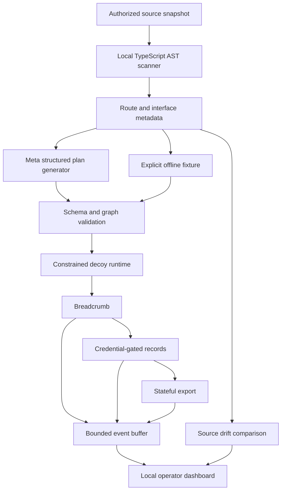

# Honeyweb

**Turn an application’s source metadata into a connected deception trail.**

Honeyweb scans a TypeScript/Express source snapshot, asks a Meta model for a declarative decoy plan, and runs three connected HTTP surfaces with synthetic records. A dashboard shows the actual requests and identifies when the source schema has drifted from the deployed graph.

Early local prototype for the Meta Global AI Developer Hackathon. Not a production security product. The live Meta integration is implemented; a successful call with a real API key still needs to be verified.

## Run it

Requires Node.js 24+ and npm.

```bash
git clone https://github.com/roshan-amble/honeyweb.git
cd honeyweb
npm ci
npm run build
npm start
```

Open **http://127.0.0.1:4310**. Decoys listen separately at **http://127.0.0.1:4311**. Use the literal `127.0.0.1` URL; the admin server enforces its Host and Origin.

The workspace starts with an explicitly labeled **offline fixture**. This mode makes no model calls and needs no API key. Click **Run demo traversal** to make three real HTTP requests. Generated telemetry is labeled `demo`, not presented as a real attack.

## Use Meta

```bash
cp .env.example .env
# Set MODEL_API_KEY in .env using your editor. Do not commit it.
npm start
```

Choose **Meta model**, then **Generate & deploy**. The server uses Meta’s OpenAI-compatible `https://api.meta.ai/v1/chat/completions` endpoint and structured JSON output. Default model: `muse-spark-1.3`, configurable with `META_MODEL`. Your account must have model access and available credits. No credit purchase or account setup is automated.

Only extracted route/interface metadata is sent to Meta, not source bodies, comments, default values, or local environment files. Metadata itself can still be confidential. The dashboard uses only the bundled synthetic fixtures. Review the CLI’s scan output and your data-sharing permission before sending a private repository’s metadata.

Model failure leaves the existing deployment intact and displays an error. There is **no silent offline fallback**. Model output selects names, endpoints, and an observed entity; it never becomes executable code. Runtime data, authentication, links, and state transitions are implemented locally.

## Try the demo

1. Inspect the v1 `Customer` schema and the connected graph.
2. Generate a Meta plan, or explicitly select the offline fixture.
3. Run traversal: integration breadcrumb → credential-gated records → export.
4. Watch three correlated requests appear. An external manual request is labeled `unclassified`.
5. Select **v2 · Account** and click **Scan**. The old deployment remains active, and drift is highlighted.
6. Generate again. The graph uses the new entity, synthetic records gain its fields, and old credentials expire immediately.

The export and collection use the same records. A session’s export status changes from `ready` to `downloaded` after access. Records are generated from interface fields, not copied from a real database. Unknown or complex types become `null`; this is not a full application emulator.

## Scan your own authorized snapshot

```bash
npm run scan -- /absolute/path/to/typescript/source
npm run generate -- /absolute/path/to/typescript/source --offline
# Makes a real Meta request and prints the validated plan:
npm run generate -- /absolute/path/to/typescript/source
```

The CLI prints JSON. In this first slice, custom plans are not imported into the dashboard; the dashboard only deploys its two fixtures. Custom-source deployment is a next milestone.

Scanner support is intentionally narrow: direct `app.get(...)` / `router.post(...)` declarations instantiated from Express imports, plus TypeScript interface fields. It does not resolve mount prefixes, dynamic routes, aliases, imported types, Zod schemas, or actual deployment topology. It parses without importing or executing source. Hidden files, symlinks, dependency/build directories, and declaration files are skipped. Use a stable local checkout, not a directory another process can maliciously mutate during scanning.

## Architecture



Domain logic lives in `src/plan.ts`, `src/scanner.ts`, and `src/runtime.ts`. The Meta HTTP adapter is `src/meta.ts`; HTTP orchestration is `src/server.ts`; the React dashboard is under `web/`. No database, agent framework, or arbitrary model-generated execution is required.

## Verify

```bash
npm run check
```

Tests cover metadata extraction and excluded values, drift, rejected plans, the mocked Meta API contract, real HTTP credential gating, consistent records, state transitions, token redaction, credential rotation, demo labeling, and cross-origin/admin separation. They do not prove production security or test a live Meta account.

`npm run dev` watches server changes. Re-run `npm run build` after dashboard changes.

## Boundaries and next work

- Both listeners bind to loopback. They run in one Node process; separate ports are **not** a sandbox or a privilege boundary.
- No production network/database integration, automated production deployment, SIEM integration, durable storage, or internet exposure is included.
- At most 1,000 events and 500 active credentials are retained in memory. Credentials last 15 minutes or until redeploy. Restart loses state.
- Correlation follows a disposable credential, not a verified person. A decoy hit is a signal for investigation, not proof of malicious intent.
- Next: validate a real Meta generation; deploy an approved custom-source plan; add process/container isolation with egress denial; evaluate decoy credibility against a declared baseline; record the 3-minute demo.

See [security boundaries](SECURITY.md), [hackathon checklist](docs/HACKATHON.md), and [demo script](docs/DEMO.md).

## Sources

- [Meta API quickstart](https://dev.meta.ai/docs/quickstart)
- [Meta structured output](https://dev.meta.ai/docs/structured-output)
- [Hackathon participant details](https://cerebralvalley.ai/e/meta-ai-developer-hackathon/details)

Original project implementation begun October 28, 2026 (Pacific). MIT licensed.
